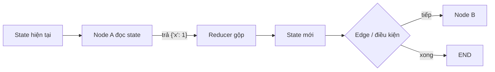

# Bài 1 — Giới thiệu & cầu nối từ HF Agents Course

⏱️ ~1 ngày · 🎬 Video: *Introduction*

## 🎯 Mục tiêu
- Đặt LangGraph vào đúng vị trí so với smolagents / LlamaIndex mà mày đã học.
- Hiểu **mental model thực thi** của LangGraph (thứ mà khóa DeepLearning.AI không nói rõ).
- Chạy được graph đầu tiên — không cần LLM.

---

## 📖 Lý thuyết

### 1.1 Mày đã biết gì, và còn thiếu gì

HF Agents Course dạy mày **agent là gì** (Thought → Action → Observation) và cho thử nhiều framework. LangGraph ở HF course chỉ lướt qua (Unit 2.3: email sorting, document analysis). Khóa này đào sâu **cách điều khiển** agent.

| | smolagents | LlamaIndex | **LangGraph** |
|--|-----------|-----------|--------------|
| Triết lý | Agent tự quyết hết (code agent) | RAG-first, workflow theo event | **Mày định nghĩa luồng**, LLM quyết ở các điểm mày cho phép |
| Mức kiểm soát | Thấp | Trung bình | **Cao** |
| Vòng lặp / rẽ nhánh | Ẩn trong agent | Event-driven | **Tường minh**: node + edge |
| State | Memory của agent | Context | **State có schema + reducer** |
| Lưu/khôi phục, time travel | Hạn chế | Hạn chế | **Có sẵn** (checkpointer) |
| Human-in-the-loop | Tự làm | Có | **First-class** (`interrupt`) |
| Hợp với | Prototype nhanh, task mở | Hỏi đáp trên tài liệu | **Hệ thống production cần tin cậy** |

> 💡 Câu tóm gọn: *smolagents cho LLM lái xe; LangGraph vẽ đường ray, LLM chỉ bẻ ghi ở các điểm rẽ.*

### 1.2 Phổ "mức độ tự chủ" của hệ thống LLM

```
Code cứng ──► LLM call ──► Chain ──► Router ──► State machine ──► Agent tự chủ hoàn toàn
                                                 ▲
                                          LangGraph mạnh nhất ở đây
                                    (có cycle, có rẽ nhánh, nhưng kiểm soát được)
```

Thực tế production: càng tự chủ càng khó tin cậy. LangGraph cho phép chọn **đúng mức tự chủ** cho từng phần.

### 1.3 Các design pattern của agent (sẽ gặp trong khóa)

| Pattern | Ý nghĩa | Bài |
|--------|--------|-----|
| **Tool use** | LLM gọi hàm bên ngoài | 2, 3, 4 |
| **Planning** | Lập kế hoạch trước khi làm | 7 |
| **Reflection** | Tự phê bình & sửa | 7 |
| **Memory / Persistence** | Nhớ giữa các lượt / phiên | 5, 8 |
| **Human-in-the-loop** | Người duyệt/sửa giữa chừng | 6 |
| **Multi-agent** | Nhiều agent chuyên biệt phối hợp | 8 |

### 1.4 Mental model thực thi của LangGraph ⭐ (quan trọng nhất bài)

LangGraph dựa trên mô hình **Pregel / Bulk Synchronous Parallel**. Nhớ 4 câu:

1. **State** là một dict dùng chung, có schema (thường là `TypedDict`).
2. **Node** là hàm `state -> dict`. Node **không trả cả state**, chỉ trả **phần cần cập nhật**.
3. **Reducer** quyết định cách gộp phần cập nhật vào state: mặc định là *ghi đè*; với `Annotated[list, operator.add]` là *nối thêm*.
4. Graph chạy theo **super-step**: mỗi step, tất cả node được kích hoạt chạy (có thể song song) → gộp update qua reducer → đi theo edge → step kế tiếp… cho tới khi tới `END`.



Hệ quả cần nhớ:
- Hai node chạy song song cùng ghi 1 key **không có reducer** → lỗi `InvalidUpdateError`.
- Có vòng lặp → có giới hạn `recursion_limit` (mặc định 25 step) → vượt sẽ ném `GraphRecursionError`.
- Mỗi super-step là một **checkpoint** (bài 5) → nền tảng cho memory, HITL, time travel.

### 1.5 Bản đồ khóa học

```
Bài 2: Tự build agent bằng Python thuần  → thấy "đau" ở đâu
Bài 3: LangGraph giải quyết cái đau đó   → State/Node/Edge
Bài 4: Tool quan trọng nhất: search
Bài 5: Nhớ + stream
Bài 6: Cho người can thiệp
Bài 7: Ghép tất cả thành 1 ứng dụng thật (Essay Writer)
```

---

## 🛠️ Thực hành

### Lab 1.1 — Gọi LLM qua `init_chat_model`
```python
import os
from dotenv import load_dotenv
from langchain.chat_models import init_chat_model

load_dotenv()
model = init_chat_model("ollama:qwen3:8b", temperature=0, reasoning=False, num_ctx=8192)
# Dùng API trả phí thì thay bằng: init_chat_model(os.environ["MODEL"], temperature=0)

resp = model.invoke("Giải thích LangGraph trong 1 câu.")
print(type(resp).__name__)   # AIMessage
print(resp.content)
print(resp.usage_metadata)   # số token vào/ra
```
👉 Quan sát: kết quả là `AIMessage`, không phải string. Mọi thứ trong LangGraph xoay quanh các **message object**.

### Lab 1.2 — Graph đầu tiên, không LLM
Mục tiêu: cảm nhận state, reducer, conditional edge, vòng lặp.

```python
import operator
from typing import Annotated, TypedDict
from langgraph.graph import StateGraph, START, END

class State(TypedDict):
    count: int                                  # ghi đè
    log: Annotated[list[str], operator.add]     # nối thêm

def increment(state: State):
    return {"count": state["count"] + 1, "log": [f"tăng lên {state['count'] + 1}"]}

def report(state: State):
    return {"log": [f"XONG với count={state['count']}"]}

def should_continue(state: State):
    return "increment" if state["count"] < 3 else "report"

builder = StateGraph(State)
builder.add_node("increment", increment)
builder.add_node("report", report)
builder.add_edge(START, "increment")
builder.add_conditional_edges("increment", should_continue, ["increment", "report"])
builder.add_edge("report", END)
graph = builder.compile()

print(graph.invoke({"count": 0, "log": []}))
print(graph.get_graph().draw_mermaid())   # dán vào https://mermaid.live để xem
```

Trong notebook có thể vẽ trực tiếp:
```python
from IPython.display import Image
Image(graph.get_graph().draw_mermaid_png())
```

### Lab 1.3 — Xem từng super-step
```python
for step in graph.stream({"count": 0, "log": []}, stream_mode="updates"):
    print(step)
```
👉 Mỗi dòng là **một super-step**: node nào chạy, trả về update gì.

---

## 🏋️ Bài tập

- 🟢 **1.1** Đổi `log` thành `log: list[str]` (bỏ reducer). Chạy lại. Kết quả khác gì? Giải thích.
- 🟢 **1.2** Truyền `{"count": 0, "log": []}` với config `{"recursion_limit": 3}` vào `invoke`. Chuyện gì xảy ra? Sửa sao cho chạy được với limit đó mà không đổi `recursion_limit`?
- 🟡 **1.3** Thêm node `double` chạy **song song** với `increment` (cùng xuất phát từ `START`), cả hai ghi vào `log`. Sau đó cho cả hai cùng ghi vào `count` → đọc lỗi và giải thích bằng mental model 1.4.
- 🔴 **1.4** Viết reducer tự chế `keep_last_3(old, new)` chỉ giữ 3 phần tử cuối của `log`. Dùng `Annotated[list[str], keep_last_3]`.

---

## ❓ Quiz tự kiểm tra

1. Node trả về `{"x": 5}` trong khi state có `x`, `y`, `z`. Sau node, `y` và `z` ra sao?
2. Khác nhau giữa `add_edge` và `add_conditional_edges`?
3. Vì sao LangGraph cần reducer, trong khi smolagents không cần khái niệm này?
4. Super-step là gì? Nó liên quan gì đến checkpoint?
5. Khi nào **không nên** dùng LangGraph?

<details><summary>Đáp án</summary>

1. Giữ nguyên. Node chỉ trả update một phần; key không được nhắc tới không đổi.
2. `add_edge` luôn đi tới node đích. `add_conditional_edges` gọi một hàm route đọc state để chọn node tiếp theo (hoặc `END`).
3. LangGraph cho phép nhiều node cập nhật state (kể cả song song) và state là dữ liệu có schema dùng chung → cần luật gộp rõ ràng. smolagents chỉ có 1 agent nối thêm vào memory theo tuần tự.
4. Một "nhịp" thực thi: các node được kích hoạt chạy, update được gộp, rồi mới sang nhịp kế. Checkpointer lưu state sau mỗi super-step.
5. Task đơn giản 1–2 LLM call không cần vòng lặp/rẽ nhánh/persistence; prototype cực nhanh mà không cần kiểm soát luồng → dùng `create_agent` hoặc gọi LLM thẳng là đủ.
</details>

---

## 🚀 Milestone dự án: **M0**
Đọc [project/PROJECT.md](../project/PROJECT.md), chọn đề, vẽ kiến trúc nháp (giấy hoặc mermaid) → lưu vào `project/ARCHITECTURE.md`.
