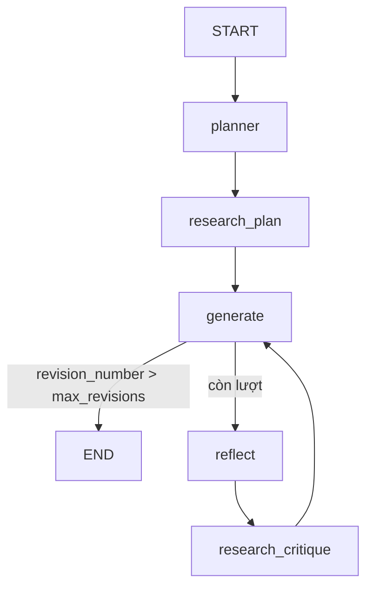

# Bài 7 — Essay Writer (dự án tổng hợp của khóa)

⏱️ ~3 ngày · 🎬 Video: *Essay Writer*

## 🎯 Mục tiêu
- Thiết kế một hệ **không phải chatbot**: state riêng (không chỉ messages), nhiều vai trò LLM.
- Áp dụng pattern **Plan → Research → Generate → Reflect → Revise**.
- Dùng structured output để LLM sinh dữ liệu cho code (danh sách query).
- Tìm & sửa điểm yếu thiết kế trong code mẫu của khóa học.

---

## 📖 Lý thuyết

### 7.1 Kiến trúc



| Node | Vai trò LLM | Đọc | Ghi |
|-----|------------|-----|-----|
| `planner` | Biên tập viên lập dàn ý | `task` | `plan` |
| `research_plan` | Nhà nghiên cứu: sinh query từ đề bài | `task` | `content` |
| `generate` | Người viết | `task`, `plan`, `content` | `draft`, `revision_number` |
| `reflect` | Giáo viên chấm bài | `draft` | `critique` |
| `research_critique` | Nhà nghiên cứu: sinh query từ lời phê | `critique` | `content` |

### 7.2 Ý tưởng thiết kế đáng học
- **State có cấu trúc** thay vì nhồi tất cả vào messages → mỗi node chỉ thấy đúng thứ nó cần, prompt ngắn & tập trung.
- **Role specialization**: cùng 1 model, khác system prompt → hành xử như các chuyên gia khác nhau.
- **Reflection** (Self-Refine / Reflexion): output được phê bình rồi sửa, chất lượng tăng rõ.
- **Dừng có kiểm soát**: `max_revisions` chặn vòng lặp vô hạn.
- **Structured output**: `model.with_structured_output(Queries)` → trả về object Pydantic, code dùng được ngay.

### 7.3 Plan-and-Execute vs ReAct

| ReAct | Plan-and-Execute |
|-------|-----------------|
| Nghĩ từng bước, quyết định ngay | Lập kế hoạch tổng trước, rồi thực thi |
| Linh hoạt, nhưng dễ lạc hướng ở task dài | Mạch lạc ở task dài, ít LLM call "quyết định" |

Essay Writer là Plan-and-Execute + Reflection, **luồng cố định** — LLM không chọn node, chỉ sinh nội dung.

---

## 🛠️ Thực hành

### Lab 7.1 — Build Essay Writer

```python
import os
from typing import TypedDict
from dotenv import load_dotenv
from pydantic import BaseModel
from tavily import TavilyClient
from langchain.chat_models import init_chat_model
from langchain_core.messages import SystemMessage, HumanMessage
from langgraph.graph import StateGraph, START, END
from langgraph.checkpoint.memory import InMemorySaver

load_dotenv()
model = init_chat_model("ollama:qwen3:8b", temperature=0, reasoning=False, num_ctx=8192)
tavily = TavilyClient(api_key=os.environ["TAVILY_API_KEY"])

class AgentState(TypedDict):
    task: str
    plan: str
    draft: str
    critique: str
    content: list[str]
    revision_number: int
    max_revisions: int

class Queries(BaseModel):
    queries: list[str]

PLAN_PROMPT = """You are an expert writer tasked with writing a high level outline of an essay. \
Write such an outline for the user provided topic. Give an outline of the essay along with any relevant notes \
or instructions for the sections."""

WRITER_PROMPT = """You are an essay assistant tasked with writing excellent 5-paragraph essays. \
Generate the best essay possible for the user's request and the initial outline. \
If the user provides critique, respond with a revised version of your previous attempts. \
Utilize all the information below as needed:

------

{content}"""

REFLECTION_PROMPT = """You are a teacher grading an essay submission. \
Generate critique and recommendations for the user's submission. \
Provide detailed recommendations, including requests for length, depth, style, etc."""

RESEARCH_PLAN_PROMPT = """You are a researcher charged with providing information that can \
be used when writing the following essay. Generate a list of search queries that will gather \
any relevant information. Only generate 3 queries max."""

RESEARCH_CRITIQUE_PROMPT = """You are a researcher charged with providing information that can \
be used when making any requested revisions (as outlined below). \
Generate a list of search queries that will gather any relevant information. Only generate 3 queries max."""

def plan_node(state: AgentState):
    response = model.invoke([SystemMessage(PLAN_PROMPT), HumanMessage(state["task"])])
    return {"plan": response.content}

def research_plan_node(state: AgentState):
    queries = model.with_structured_output(Queries).invoke(
        [SystemMessage(RESEARCH_PLAN_PROMPT), HumanMessage(state["task"])]
    )
    content = state.get("content") or []
    for q in queries.queries:
        for r in tavily.search(query=q, max_results=2)["results"]:
            content.append(r["content"])
    return {"content": content}

def generation_node(state: AgentState):
    content = "\n\n".join(state.get("content") or [])
    user_message = HumanMessage(f"{state['task']}\n\nHere is my plan:\n\n{state['plan']}")
    response = model.invoke([SystemMessage(WRITER_PROMPT.format(content=content)), user_message])
    return {"draft": response.content, "revision_number": state.get("revision_number", 1) + 1}

def reflection_node(state: AgentState):
    response = model.invoke([SystemMessage(REFLECTION_PROMPT), HumanMessage(state["draft"])])
    return {"critique": response.content}

def research_critique_node(state: AgentState):
    queries = model.with_structured_output(Queries).invoke(
        [SystemMessage(RESEARCH_CRITIQUE_PROMPT), HumanMessage(state["critique"])]
    )
    content = state.get("content") or []
    for q in queries.queries:
        for r in tavily.search(query=q, max_results=2)["results"]:
            content.append(r["content"])
    return {"content": content}

def should_continue(state: AgentState):
    return END if state["revision_number"] > state["max_revisions"] else "reflect"

builder = StateGraph(AgentState)
builder.add_node("planner", plan_node)
builder.add_node("research_plan", research_plan_node)
builder.add_node("generate", generation_node)
builder.add_node("reflect", reflection_node)
builder.add_node("research_critique", research_critique_node)
builder.add_edge(START, "planner")
builder.add_edge("planner", "research_plan")
builder.add_edge("research_plan", "generate")
builder.add_conditional_edges("generate", should_continue, {END: END, "reflect": "reflect"})
builder.add_edge("reflect", "research_critique")
builder.add_edge("research_critique", "generate")
graph = builder.compile(checkpointer=InMemorySaver())

thread = {"configurable": {"thread_id": "essay-1"}}
for step in graph.stream(
    {"task": "What is the difference between LangChain and LangSmith", "max_revisions": 2, "revision_number": 1},
    thread,
    stream_mode="updates",
):
    for node, update in step.items():
        print(f"\n===== {node} =====")
        print({k: (v[:300] if isinstance(v, str) else v) for k, v in update.items() if k != "content"})
```

### Lab 7.2 — Đọc kết quả
```python
final = graph.get_state(thread).values
print(final["draft"])
print("Số đoạn research:", len(final["content"]))
```
Mở LangSmith (nếu bật) xem trace: node nào tốn token nhất?

---

## 🏋️ Bài tập

- 🟢 **7.1 — Bug hunt.** `WRITER_PROMPT` nói "If the user provides critique…" nhưng `generation_node` **không hề đưa `critique` và bản nháp cũ** cho writer. Writer chỉ hưởng lợi gián tiếp qua research. Sửa lại: khi có `critique`, gửi thêm bản nháp trước + lời phê. So sánh chất lượng bản cuối trước/sau khi sửa.
- 🟢 **7.2** Viết essay tiếng Việt: thêm field `language` vào state, chèn vào prompt.
- 🟡 **7.3 — Bug ẩn #2.** `content = state.get("content") or []` rồi `.append` → **sửa trực tiếp list trong state** (mutation). Đổi sang reducer `Annotated[list[str], operator.add]`, node chỉ trả về phần *mới*. Thêm bước bỏ trùng.
- 🟡 **7.4** HITL cho dàn ý: `interrupt_after=["planner"]` (hoặc `interrupt()` trong node riêng). Cho người sửa `plan` bằng `update_state(thread, {"plan": new_plan})` rồi chạy tiếp.
- 🟡 **7.5** Giữ nguồn: lưu `{"url", "content"}` thay vì chỉ content; yêu cầu writer trích dẫn `[n]` và in danh sách nguồn cuối bài.
- 🔴 **7.6** Thay `max_revisions` cố định bằng chấm điểm:
  ```python
  class Grade(BaseModel):
      score: int            # 1-10
      critique: str
  ```
  Dừng khi `score >= 8` **hoặc** hết `max_revisions`. Vẽ lại graph.
- 🔴 **7.7** UI Streamlit: tab *Plan / Research / Draft / Critique*, cập nhật realtime theo `stream_mode="updates"`, nút "Sửa plan" (dùng HITL 7.4). (Khóa học có GUI viết bằng Panel — mày tự làm phiên bản của mình.)

---

## ❓ Quiz tự kiểm tra

1. Vì sao state ở đây không dùng `messages`?
2. `with_structured_output` giải quyết vấn đề gì so với parse text?
3. `revision_number` bắt đầu 1, `max_revisions=2` → writer viết bao nhiêu lần?
4. Nêu 2 điểm yếu của luồng cố định này so với ReAct.
5. Vì sao mutate list trong state là ý tưởng tồi khi có checkpointer?

<details><summary>Đáp án</summary>

1. Mỗi vai trò cần ngữ cảnh khác nhau; nhồi vào một chuỗi messages làm prompt dài, lẫn lộn vai trò.
2. Đảm bảo output đúng schema (list query) để code dùng trực tiếp, không cần regex/JSON parse thủ công.
3. Lần 1: 1→2 (2 > 2? không → reflect). Lần 2: 2→3 (3 > 2 → END). **2 lần**.
4. Không tự bỏ qua bước thừa (vd đề dễ vẫn research); không tự quyết search thêm khi thiếu thông tin ngoài 2 điểm research cố định.
5. Object có thể đang được tham chiếu bởi checkpoint trước → lịch sử bị sửa ngầm, time travel/replay sai; và bỏ qua cơ chế reducer nên update khó đoán.
</details>

---

## 🚀 Milestone dự án: **M5**
Module viết của dự án có vòng reflection + dừng theo điểm. Xem [PROJECT.md](../project/PROJECT.md).
