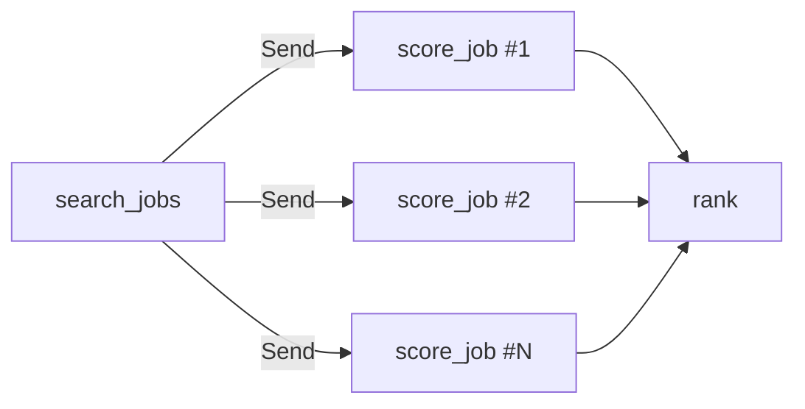

# Bài 8 — Tài nguyên LangChain & Pattern nâng cao

⏱️ ~4 ngày · 🎬 Video: *LangChain Resources* + *Conclusion*

> Video bài này ngắn (giới thiệu tài nguyên). Phần lớn bài là kiến thức **ngoài khóa học** — những thứ mày cần để dự án cá nhân thật sự "hay ho".

## 🎯 Mục tiêu
- Map-reduce song song với `Send`.
- Subgraph — đóng gói graph thành module.
- Multi-agent: supervisor & handoff.
- Long-term memory với `Store`.

---

## 📚 Phần A — Tài nguyên (từ video)

| Tài nguyên | Dùng để |
|-----------|--------|
| [LangGraph docs](https://docs.langchain.com/oss/python/langgraph/overview) | Tra cứu chính thức — đọc mục *Concepts* trước, *How-to* khi cần |
| [LangChain Academy – Intro to LangGraph](https://academy.langchain.com/courses/intro-to-langgraph) | Free, sâu hơn khóa này — **nên học tiếp sau giáo trình** |
| [LangSmith](https://smith.langchain.com) | Trace, eval, prompt playground |
| [LangGraph GitHub examples](https://github.com/langchain-ai/langgraph/tree/main/examples) | Code mẫu: multi-agent, RAG, plan-and-execute… |
| LangGraph Studio (`langgraph dev`) | IDE trực quan: xem graph chạy, sửa state, time travel bằng UI |

---

## 📖 Phần B — Lý thuyết nâng cao

### 8.1 Map-reduce với `Send`
Khi số nhánh song song **không biết trước** (vd: chấm điểm N tin tuyển dụng tìm được):

```python
from langgraph.types import Send

def fan_out(state):
    return [Send("score_job", {"job": j, "profile": state["profile"]}) for j in state["jobs"]]

builder.add_conditional_edges("search_jobs", fan_out, ["score_job"])
```
- Mỗi `Send` tạo một lần chạy node `score_job` với **state riêng** (payload).
- Các lần chạy song song trong cùng super-step; kết quả gộp qua reducer:
  `scores: Annotated[list[dict], operator.add]`.



### 8.2 Subgraph
Một graph đã compile có thể làm **node** của graph khác.
- **Chung key state** → `builder.add_node("research", research_graph)` trực tiếp.
- **Khác schema** → bọc trong hàm: chuyển state cha → input con, gọi `research_graph.invoke(...)`, chuyển output về.

Lợi ích: module hóa, test riêng, tái sử dụng (vd: deep-search graph ở bài 4.5).

### 8.3 Multi-agent

| Kiến trúc | Mô tả | Hợp khi |
|----------|------|--------|
| **Supervisor** | 1 LLM điều phối chọn worker nào làm tiếp | Các worker chuyên biệt rõ ràng |
| **Network / Swarm** | Agent tự chuyển quyền cho nhau (handoff) | Hội thoại chuyển chủ đề linh hoạt |
| **Hierarchical** | Supervisor của các supervisor | Hệ thống lớn |
| **Pipeline cố định** | Như bài 7 | Quy trình đã rõ |

Supervisor tối giản bằng structured output + `Command`:
```python
from typing import Literal
from pydantic import BaseModel
from langgraph.types import Command

class Route(BaseModel):
    next: Literal["researcher", "writer", "FINISH"]

def supervisor(state) -> Command[Literal["researcher", "writer", "__end__"]]:
    route = model.with_structured_output(Route).invoke([SystemMessage(SUPERVISOR_PROMPT)] + state["messages"])
    return Command(goto=END if route.next == "FINISH" else route.next)
```
Mỗi worker xong việc → `add_edge("researcher", "supervisor")`.

> ⚠️ Multi-agent không miễn phí: thêm LLM call, khó debug. Chỉ tách agent khi một agent có quá nhiều tool / prompt quá dài / cần chuyên môn khác biệt.

### 8.4 Long-term memory với `Store`
Checkpointer nhớ **trong 1 thread**. `Store` nhớ **xuyên thread**, theo namespace.

```python
import uuid
from langgraph.store.memory import InMemoryStore
from langgraph.store.base import BaseStore
from langchain_core.runnables import RunnableConfig

store = InMemoryStore()

def call_model(state: MessagesState, config: RunnableConfig, *, store: BaseStore):
    ns = ("memories", config["configurable"]["user_id"])
    memories = "\n".join(m.value["data"] for m in store.search(ns))
    system = f"You are a helpful assistant. What you know about the user:\n{memories}"
    response = model.invoke([SystemMessage(system)] + state["messages"])
    last = state["messages"][-1].content
    if "remember" in last.lower():                        # đơn giản hóa — bài tập 8.4 sẽ làm xịn hơn
        store.put(ns, str(uuid.uuid4()), {"data": last})
    return {"messages": [response]}

graph = builder.compile(checkpointer=InMemorySaver(), store=store)
graph.invoke({"messages": [HumanMessage("Remember: I prefer Python jobs in Hanoi")]},
             {"configurable": {"thread_id": "t1", "user_id": "tin"}})
graph.invoke({"messages": [HumanMessage("What jobs should I look for?")]},
             {"configurable": {"thread_id": "t2", "user_id": "tin"}})     # thread khác vẫn nhớ
```
- Store hỗ trợ **semantic search** khi khởi tạo với `index={"embed": ..., "dims": ...}`. Máy mày có sẵn `nomic-embed-text` (768 chiều) → miễn phí:
  ```python
  from langchain_ollama import OllamaEmbeddings
  store = InMemoryStore(index={"embed": OllamaEmbeddings(model="nomic-embed-text"), "dims": 768})
  store.search(ns, query="user muốn làm việc ở đâu?")
  ```
- Production: `PostgresStore`.
- LangGraph 1.x còn cách khác: khai báo `runtime: Runtime[...]` trong node và dùng `runtime.store` — tra docs mục *Memory*.

### 8.5 LangChain 1.x `create_agent` + middleware
Agent ReAct có sẵn với middleware: tóm tắt hội thoại, HITL cho tool, giới hạn số lần gọi model… Rất hợp làm **worker** bên trong graph tùy biến của mày.

---

## 🛠️ Thực hành

### Lab 8.1 — Map-reduce: tóm tắt N bài báo song song
1. Node `search`: Tavily `topic="news"` lấy 5 bài về một chủ đề → `articles: list[dict]`.
2. `fan_out` → `Send("summarize_one", {"article": a})`.
3. `summarize_one` trả `{"summaries": [summary]}` (reducer `operator.add`).
4. Node `digest` gộp thành bản tin 5 gạch đầu dòng.
👉 Bật LangSmith và nhìn 5 nhánh chạy song song.

### Lab 8.2 — Subgraph
Lấy graph deep-search (bài tập 4.5) làm node trong Essay Writer, thay `research_plan`.

### Lab 8.3 — Supervisor với 2 worker
- `researcher`: `create_agent` với Tavily tool.
- `writer`: LLM viết lại thông tin thành bài đăng LinkedIn.
- `supervisor` như 8.3. Test: *"Tìm 3 tin AI nổi bật tuần này và viết thành post LinkedIn"*.

### Lab 8.4 — Long-term memory
Chạy đoạn code 8.4, kiểm tra thread khác vẫn nhớ.

---

## 🏋️ Bài tập

- 🟢 **8.1** Lab 8.1: thêm field `topic` trong payload `Send` và để `digest` nhóm theo topic.
- 🟡 **8.2** Supervisor bị lặp vô hạn (researcher ↔ supervisor)? Thêm bộ đếm và luật dừng.
- 🟡 **8.3** Subgraph khác schema: graph con dùng `{"question", "answer"}`, graph cha dùng `messages`. Viết hàm bọc chuyển đổi.
- 🔴 **8.4** Memory "xịn": thay `if "remember" in ...` bằng một LLM call structured output trích **sự kiện đáng nhớ** (`list[str]`) sau mỗi lượt, cập nhật/xóa memory cũ mâu thuẫn.

---

## ❓ Quiz tự kiểm tra

1. Khi nào dùng `Send` thay vì vẽ sẵn nhiều edge song song?
2. Node nhận payload từ `Send` có đọc được state chung của graph không?
3. Checkpointer vs Store — chọn cái nào để lưu "sở thích của user"?
4. Dấu hiệu nào cho thấy nên tách thành multi-agent?
5. `Command(goto=...)` khác conditional edge ở điểm nào?

<details><summary>Đáp án</summary>

1. Khi số nhánh phụ thuộc dữ liệu lúc chạy (N kết quả search).
2. Không — nó chỉ nhận đúng payload trong `Send`. Muốn dữ liệu gì thì phải đưa vào payload.
3. Store (xuyên thread, theo user). Checkpointer chỉ gắn với một thread.
4. Một agent có quá nhiều tool chọn sai; prompt quá dài và mâu thuẫn; các phần việc cần chuyên môn/model khác nhau; cần test/phát triển độc lập.
5. `Command` cho node vừa update state vừa quyết định đi đâu ngay trong node (logic nằm một chỗ, hỗ trợ cả nhảy lên graph cha). Conditional edge tách việc định tuyến ra hàm riêng, chạy sau node.
</details>

---

## 🚀 Milestone dự án: **M6**
Dự án thành hệ multi-agent hoàn chỉnh với `Send` + Store. Xem [PROJECT.md](../project/PROJECT.md).
