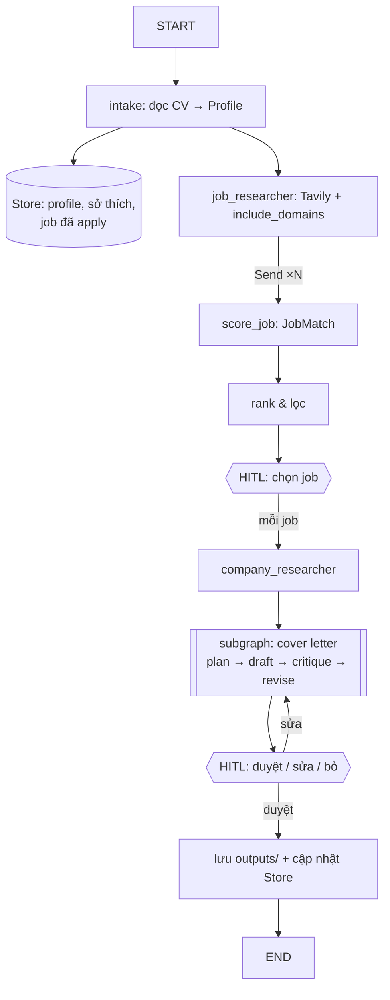

# 🚀 Dự án cá nhân

Dự án được xây **dần qua từng bài**: học xong bài nào thì gắn tính năng đó vào. Học xong giáo trình là có luôn một sản phẩm deploy được để bỏ vào portfolio/CV.

---

## 1. Chọn đề

Cả 4 đề dưới đây dùng **cùng một bộ kỹ năng** (tool, search, memory, HITL, reflection, multi-agent, deploy), nên milestone áp dụng được cho đề nào cũng được. Tao đề xuất **JobPilot** vì nó hữu ích ngay cho bản thân mày và gây ấn tượng khi đi phỏng vấn ("em dùng chính agent này để apply vào đây").

### ⭐ Đề A — JobPilot: Copilot săn việc (khuyên chọn)
Đưa CV + mong muốn → agent tìm job trên các trang tuyển dụng VN, chấm độ phù hợp, nghiên cứu công ty, viết cover letter riêng cho từng job. Mày duyệt trước khi lưu/gửi.

### Đề B — StudyBuddy: Gia sư từ tài liệu của chính mày
Đưa PDF/slide môn học → agent lập kế hoạch ôn, sinh quiz, chấm câu trả lời, tìm tài liệu bổ sung trên web, nhớ chỗ mày hay sai (long-term memory).

### Đề C — TechRadar VN: Bản tin công nghệ cá nhân hóa
Mỗi ngày quét tin/paper/repo theo sở thích → tóm tắt song song → viết bản tin → mày duyệt → gửi Telegram/Email.

### Đề D — Tự đề xuất
Điều kiện: có ≥ 3 tool, có hành động cần người duyệt, có bước sinh nội dung dài cần reflection, có dữ liệu cần nhớ xuyên phiên.

> ✍️ Đề đã chọn: `__________` (ghi vào `PROGRESS.md` luôn)

---

## 2. Kiến trúc mục tiêu (JobPilot)



Pydantic model gợi ý:
```python
class Profile(BaseModel):
    name: str
    skills: list[str]
    years_experience: float
    desired_roles: list[str]
    locations: list[str]

class JobPosting(BaseModel):
    title: str
    company: str
    url: str
    location: str | None
    requirements: list[str]

class JobMatch(BaseModel):
    job_url: str
    score: int                 # 0-100
    matched_skills: list[str]
    missing_skills: list[str]
    reasoning: str
```

Cấu trúc thư mục gợi ý:
```
project/
├── PROJECT.md
├── ARCHITECTURE.md          ← mày viết (M0)
├── src/jobpilot/
│   ├── state.py             ← State + Pydantic models
│   ├── tools.py
│   ├── prompts.py
│   ├── nodes/               ← mỗi node một file
│   ├── subgraphs/writer.py
│   └── graph.py             ← build & export `graph`
├── app.py                   ← Streamlit UI
├── tests/
├── data/sample_cv.md
├── langgraph.json
└── README.md                ← README portfolio (M7)
```

---

## 3. Milestones & Definition of Done

Chỉ tick milestone khi **đạt hết** tiêu chí. Muốn tao review: nhắn `review milestone Mx`.

### M0 — Khởi động *(sau bài 1–2)*
- [ ] Chọn đề, ghi vào `PROGRESS.md`
- [ ] `ARCHITECTURE.md`: mô tả 1 đoạn, user story chính, sơ đồ mermaid nháp
- [ ] Liệt kê ≥ 3 tool: tên, docstring, chữ ký hàm
- [ ] Chuẩn bị dữ liệu mẫu (vd `data/sample_cv.md`)

### M1 — Agent đầu tiên *(sau bài 3)*
- [ ] Graph tự build (`StateGraph` + `ToolNode` + `tools_condition`), không dùng `create_agent`
- [ ] ≥ 2 tool (cho phép trả dữ liệu giả)
- [ ] Chạy được từ CLI: `python -m jobpilot "tìm job Python junior ở Hà Nội"`
- [ ] Có ảnh graph (mermaid) trong `ARCHITECTURE.md`

### M2 — Dữ liệu thật *(sau bài 4)*
- [ ] Search thật bằng Tavily, có `include_domains` phù hợp
- [ ] Trích xuất về Pydantic model (`JobPosting`) bằng `with_structured_output`
- [ ] Có tool nghiên cứu công ty
- [ ] Xử lý khi search không ra kết quả / lỗi mạng

### M3 — Nhớ & stream *(sau bài 5)*
- [ ] `SqliteSaver`: tắt mở lại vẫn tiếp tục được thread cũ
- [ ] UI Streamlit: chat + stream token + hiện trạng thái "đang tìm…"
- [ ] Chọn/tạo thread trên sidebar
- [ ] Cắt hoặc tóm tắt messages khi thread dài

### M4 — Người duyệt *(sau bài 6)*
- [ ] `interrupt()` để người chọn job muốn theo đuổi
- [ ] Duyệt / sửa / từ chối cover letter trước khi lưu
- [ ] Không side effect nào đứng trước `interrupt()`
- [ ] Nút "quay lại bước trước" trên UI (time travel)

### M5 — Viết có phản tư *(sau bài 7)*
- [ ] Subgraph writer: plan → draft → critique → revise
- [ ] Dừng theo điểm (`Grade`) **hoặc** hết số vòng tối đa
- [ ] Writer nhận cả bản nháp cũ + lời phê (không lặp lại bug 7.1)
- [ ] Cover letter trích được thông tin cụ thể về công ty (từ research)

### M6 — Multi-agent *(sau bài 8)*
- [ ] `Send` chấm điểm N job song song
- [ ] `Store` nhớ profile + danh sách job đã apply (không gợi ý lại job cũ)
- [ ] Ít nhất 1 subgraph được tái sử dụng
- [ ] Graph tổng có thể xem trong `langgraph dev`

### M7 — Về đích *(sau bài 9)*
- [ ] LangSmith tracing + 1 eval dataset ≥ 5 case
- [ ] ≥ 8 test pytest pass
- [ ] Deploy HF Spaces, có link public
- [ ] README portfolio: vấn đề, demo GIF, kiến trúc, tech stack, cách chạy, bài học rút ra
- [ ] Post LinkedIn/blog giới thiệu dự án (tùy chọn, nhưng nên làm)

---

## 4. Stretch goals (khi đã xong M7)
- Đọc CV từ PDF (`pypdf`) và xuất cover letter ra `.docx`
- Gửi bản tóm tắt job mới mỗi sáng qua Telegram (chạy theo lịch)
- Semantic search trong Store (embedding) để nhớ thông minh hơn
- So sánh 2 model (rẻ vs mạnh) cho từng node, tối ưu chi phí
- Đánh giá trajectory: agent có search thừa không?

## 5. Rubric chấm cuối khóa (tao sẽ chấm theo cái này)

| Tiêu chí | Điểm |
|---------|-----|
| Dùng đúng & hợp lý các khái niệm LangGraph (state, reducer, edge, checkpoint, interrupt, Send, Store) | 30 |
| Chất lượng output thực tế (job phù hợp, cover letter tốt) | 20 |
| Code sạch, module hóa, có test | 20 |
| UX: stream, HITL mượt, xử lý lỗi | 15 |
| Deploy + README + demo | 15 |
| **Tổng** | **100** |
